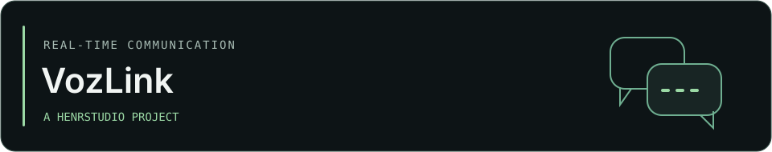
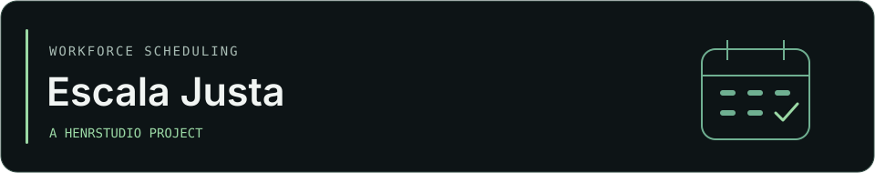
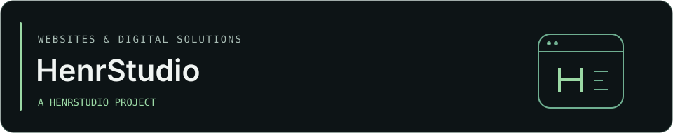

<picture>
  <source media="(prefers-reduced-motion: reduce)" srcset="./assets/banner-static.svg">
  
</picture>

# Henrique Oliveira

**Web Developer & Founder of HenrStudio**

I'm a Brazilian web developer based in Portugal, focused on modern digital
experiences, intuitive interfaces and functional products.

Through **HenrStudio**, I develop websites and digital solutions with
attention to usability, visual consistency and the details that make
a product feel considered.

## Selected projects

### VozLink

A real-time communication platform bringing together calls, messages,
groups and collaboration.

<!-- VOZLINK:START -->
<!-- VOZLINK:END -->

### Escala Justa

An application for generating and managing work schedules, with
configurable rules and fair shift distribution.

<!-- ESCALA_JUSTA:START -->
<!-- ESCALA_JUSTA:END -->

### HenrStudio

My web development brand and platform for digital services and
client project tracking.

<!-- HENRSTUDIO:START -->
<!-- HENRSTUDIO:END -->

*These projects are maintained in private repositories.*

## Technology

**Interfaces**

 React ·  TypeScript ·  JavaScript ·  HTML5 ·  CSS3

**Build & version control**

 Vite ·  Git ·  GitHub

**Data & services**

 Supabase

## GitHub activity

[Explore my contribution history and public activity](https://github.com/henrique1420?tab=overview).

<!-- SNAKE:START -->
<!-- SNAKE:END -->

## Let's connect

<!-- CONTACT:START -->
[GitHub](https://github.com/henrique1420)
<!-- CONTACT:END -->
